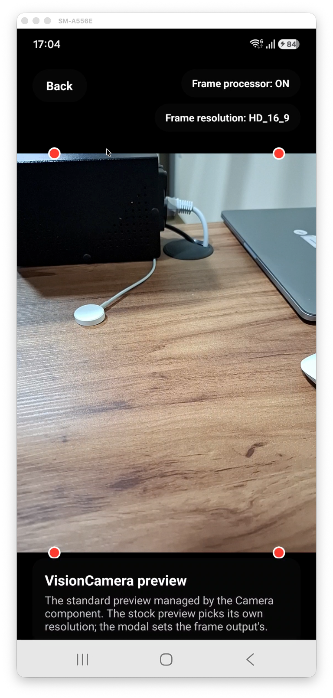
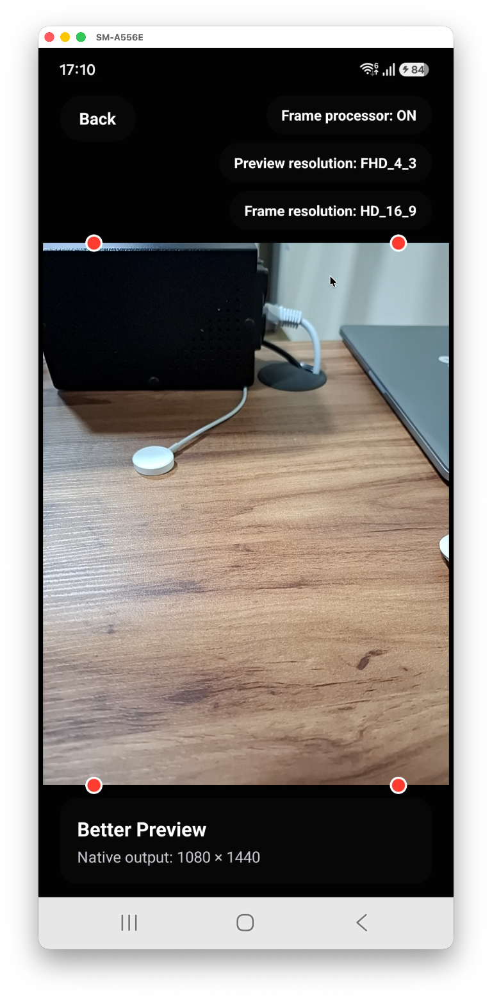
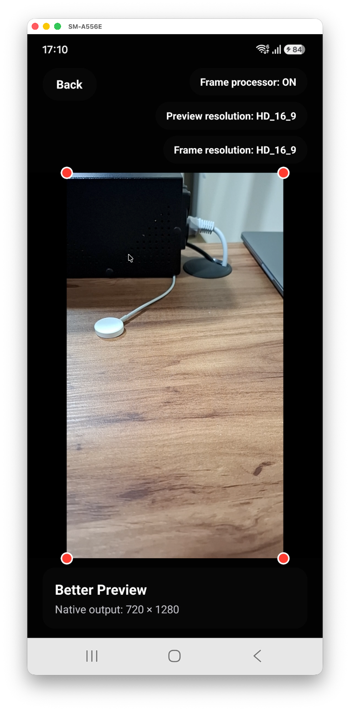
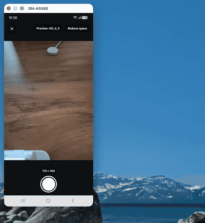

# react-native-vision-camera-better-preview

A Nitro Module workspace for building a custom native preview output for
[React Native VisionCamera](https://visioncamera.margelo.com/).

## What it fixes

1. **Aspect ratio mismatch with other outputs on Android.** CameraX gives the
   stock preview a fixed 4:3 stream while video usually resolves to 16:9. With
   this output you choose the preview's `targetResolution`, so it can match
   your frame and video outputs.
2. **Unknown preview size and rotation.** The native side reports the real
   preview resolution and rotation through `onConfigurationChanged`, so you
   know the exact aspect ratio of the preview and can position buttons,
   overlays and any other UI precisely against it.

## Why a custom preview output?

A camera session usually has more than a preview: a frame output for
processing, a photo or video output for capture. Every output is a different
view of the same sensor, and the camera can only deliver them all consistently
when their **aspect ratios agree**.

VisionCamera's built-in preview chooses its own resolution. That is fine when
the preview is all you show, but as soon as another output is attached, the
two can end up with different aspect ratios. The same sensor area is then
cropped differently for each output, so the preview can show more to the user
than your frame, photo or video can actually see (or the other way around).
Frame-based results are still correct, but they only cover part of what the
user is looking at.

This library gives the preview the power to choose. You pass a
`targetResolution` that matches your other outputs, and the preview is
negotiated with the session at that aspect ratio. The preview, the frame and
the capture then cover the same field of view, so what the user sees is
what your frame and video can see.

### Why this matters most on Android

On Android, CameraX picks a default aspect ratio per use case, and they do not
agree with each other:

- Image capture and image analysis (the frame output) default to **4:3**
  ([CameraX configuration docs](https://developer.android.com/media/camera/camerax/configuration#resolution)).
- Video usually resolves to **16:9**.
- The stock preview stays fixed at **4:3**, so you cannot change it.

With the stock preview, a 16:9 video and a 4:3 preview show different areas of
the sensor, and the preview cannot be moved to match them. Because this
library lets you choose the preview's `targetResolution`, you can align the
preview with the frame and video outputs instead: set the preview to the same
aspect ratio as the output you care about.

iOS is less affected. There, every output is derived from the active format
selected on the capture device, so the outputs are already aligned. VisionCamera
also sets `automaticallyConfiguresOutputBufferDimensions` to `false` on its
frame outputs, so the frame buffers keep the dimensions of the active format
instead of being resized automatically.

With the stock `Camera` component on iOS, the output target resolutions are
used to filter the available formats and pick the active one. You can therefore
leave the target resolution out, or steer the choice with a `resolutionBias`
constraint. Android ignores `resolutionBias`, which is why the preview cannot
be steered there without this library.

The custom preview output keeps the iOS behavior and adds the same control on
Android.

### Knowing the exact preview size for layout

`onConfigurationChanged` reports the negotiated stream resolution and, when
available, the rotation needed to display it upright. On iOS, rotation is only
reported on iOS 17 and later; on earlier iOS versions `rotationDegrees` is
`undefined`. `getUprightPreviewResolution()` applies the reported rotation for
you, so you get the size as the user sees it when rotation is available. If the
rotation is unavailable, the helper returns `undefined` rather than guessing:

```tsx
const [configuration, setConfiguration] =
  useState<BetterPreviewConfiguration>();
const previewOutput = useMemo(
  () => createPreviewOutput({ onConfigurationChanged: setConfiguration }),
  []
);

const resolution = getUprightPreviewResolution(configuration);
const aspectRatio = resolution
  ? resolution.width / resolution.height
  : undefined;

// The preview is exactly this shape, so a wrapper with this aspect ratio can
// hold the preview and the UI aligned to its edges (buttons, guides, overlays).
<View style={{ aspectRatio, width: '100%' }}>
  <NativePreviewView
    previewOutput={previewOutput}
    style={StyleSheet.absoluteFill}
  />
  <Button style={{ position: 'absolute', bottom: 0, right: 0 }} />
</View>;
```

Without this information you have to guess the preview's aspect ratio, and UI
placed relative to the preview edges drifts when the device picks a different
resolution or rotates.

### Seeing it in the example app

The example draws the four corners of the **frame output** as red dots on the
preview. If the preview and the frame cover the same area, the dots sit on the
corners of the preview. If they do not, the dots drift away from the edges.

| Standard preview                                                                       | Better Preview, mismatched                                                                                                   | Better Preview, matched                                                                     |
| -------------------------------------------------------------------------------------- | ---------------------------------------------------------------------------------------------------------------------------- | ------------------------------------------------------------------------------------------- |
|                                    |                                                                    |                                         |
| The stock preview picks its own size, so the 16:9 frame corners land inside the image. | Preview at `FHD_4_3` (1080 × 1440) with a `HD_16_9` frame: the 4:3 preview shows more than the frame, so the dots are inset. | Preview and frame both `HD_16_9` (720 × 1280): the dots sit exactly on the preview corners. |

In the example app you can change the preview and frame resolutions with the
buttons at the top and watch the dots move.

### Full control over the preview layout

The responsive preview example uses the actual upright dimensions reported by
`onPreviewResolution` to size the camera frame. The close button and camera
trigger are then positioned relative to that frame instead of the full screen.

When the selected preview resolution changes, the frame follows its real aspect
ratio. When the available space changes, the controls can move from the space
around the preview to an overlay inside it while remaining aligned with its
edges. The same geometry can drive guides, crop regions, focus indicators,
capture controls, or any other preview-bound UI, giving the application full
control over how the camera and its controls are composed.



## Current status

The custom preview output is implemented on iOS and Android. The repository
provides:

- a Swift/Kotlin Nitro Module library scaffold;
- native dependencies on VisionCamera for iOS and Android;
- a native preview output backed by `AVCaptureVideoPreviewLayer` on iOS and
  CameraX `Preview` on Android;
- a drop-in `Camera` component with preview target-resolution and resolution
  callbacks;
- preview resolution and rotation updates through a JavaScript callback;
- a React Native 0.86 example app with camera permissions configured;
- a standard VisionCamera preview to verify the development environment;
- Nitrogen, TypeScript, ESLint, and library build scripts.

## Usage

### Camera component

Import `Camera` from this package as a drop-in replacement for VisionCamera's
component. It accepts the same props and ref, plus the preview configuration
props introduced by this library:

```tsx
import { Camera } from 'react-native-vision-camera-better-preview';

<Camera
  ref={camera}
  device={device}
  isActive
  outputs={outputs}
  style={StyleSheet.absoluteFill}
  previewTargetResolution={{ width: 1920, height: 1080 }}
  onPreviewResolution={({ width, height }) => {
    console.log('Upright preview:', width, height);
  }}
  onPreviewConfigurationChanged={(configuration) => {
    console.log('Native preview configuration:', configuration);
  }}
/>;
```

`onPreviewResolution` receives dimensions after applying the display rotation,
so they are ready for upright layout calculations. On iOS it is available on
iOS 17 and newer; `onPreviewConfigurationChanged` still reports the native
resolution on earlier versions, with `rotationDegrees` left undefined.

### Imperative preview output

Create the native output once and subscribe to configuration changes:

```tsx
import {
  createPreviewOutput,
  getUprightPreviewResolution,
} from 'react-native-vision-camera-better-preview';

const previewOutput = createPreviewOutput({
  // Optional: negotiated with the session's other camera outputs.
  targetResolution: { width: 1920, height: 1080 },
  onConfigurationChanged: (configuration) => {
    const resolution = getUprightPreviewResolution(configuration);
    const aspectRatio = resolution
      ? resolution.width / resolution.height
      : undefined;

    console.log('Preview resolution:', resolution);
    console.log('Preview aspect ratio:', aspectRatio);
    console.log('Preview rotation:', configuration.rotationDegrees);
  },
});
```

`createPreviewOutput()` returns VisionCamera's `CameraOutput`. The callback
reports the native stream resolution in its unrotated orientation and, when
available, the rotation in degrees. `getUprightPreviewResolution()` swaps width
and height for quarter-turn rotations so layout code can consume the displayed
orientation directly. On iOS versions earlier than 17, rotation is unavailable
and the upright-resolution helper returns `undefined`.

## Development setup

Install all workspace dependencies:

```sh
yarn
```

Generate Nitro bindings after changing any `*.nitro.ts` file:

```sh
yarn nitrogen
```

Install iOS pods:

```sh
yarn example pod-install
```

Run the example app:

```sh
yarn example ios
yarn example android
```

Run project checks:

```sh
yarn typecheck
yarn lint
yarn prepare
```

## Architecture references

- [VisionCamera custom native CameraOutputs](https://visioncamera.margelo.com/docs/custom-native-camera-outputs)
- [How to build a Nitro Module](https://nitro.margelo.com/docs/getting-started/how-to-build-a-nitro-module)

## License

MIT

---

Made with [create-react-native-library](https://github.com/callstack/react-native-builder-bob).
